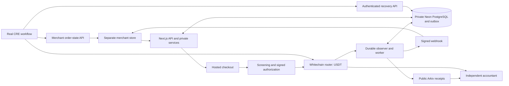

# SettleKit: six-phase implementation plan

Updated: 7 November 2026 (IST). All six phases are authorized. Latest instruction resumes verification: audit every phase, complete gaps, run the app/tests and fix failures. Main agent only. Static compilation/historical results do not close live funded/runtime gates. See `PROGRESS.md`, `docs/phases/phase-6-verification.md` and the implementation audit for current evidence.

Read with [AGENTS.md](AGENTS.md), [MEMORY.md](MEMORY.md), [PROGRESS.md](PROGRESS.md) and [PROJECT_HANDOFF.md](PROJECT_HANDOFF.md). The handoff retains the detailed product/security requirements; this document replaces its former Phase 0–4 numbering with exactly **Phases 1–6**. Current user instructions take precedence.

## Product and decisions

Build a stablecoin payment gateway that an existing business website can integrate through a small server adapter, REST API and hosted checkout. The merchant receives payment directly, operates a premium dashboard, issues screened refunds, checks independent accounting records and recovers missed order notifications.

The user confirmed these implementation preferences in this planning chat:

- Merchant login: wallet signature, with settlement-wallet ownership verification.
- Runtime: run the Next.js app and persistent worker locally first, backed by **Neon PostgreSQL**. The user's latest database choice replaces SQLite/libSQL. Public app hosting remains deferred; database access is a Phase 1 prerequisite.
- Quality: use the available design skills for a polished, distinctive product. Plan and review every requested phase before implementation, verify the complete phase afterward, then report and keep pushing coherent tested milestones.
- Schedule: complete the entire six-phase scope even if work continues beyond the event deadline.
- Execution: all six phase-start instructions have now been given. Continue remaining implementation under the latest main-agent-only/testing-deferred instruction; report gaps accurately instead of waiting for phase authorization already supplied.

Fixed product boundaries remain:

- Payments and refunds use Whitechain Sepolia, chain ID `1874`, and sponsor USDT `0xcedfB56113143d55b2358b8CFbB0dEB5Ad2f55a7`, with six decimals. Refunds return only to the original payer, in the original token and chain. See the [Whitechain track requirements](https://ethglobal.com/events/mumbai/prizes/whitechain).
- Arkiv Rabdi supplies actual public payment/refund records and a user-visible independent accountant query. Private operating data stays private. See the [Arkiv track requirements](https://ethglobal.com/events/mumbai/prizes/arkiv).
- Chainlink CRE compares Whitechain payment evidence with a separate merchant order API and initiates eligible notification recovery. Its HTTP/Whitechain route must be proven; native network support and prize eligibility are unverified. A successful real CLI simulation satisfies the track's execution requirement; it is distinct from deployed DON operation. See the [CRE track requirements](https://ethglobal.com/events/mumbai/prizes/chainlink).
- Screening is mandatory before authorization, fulfillment/recovery and refunds. Missing or stale required evidence cannot silently pass. AI remains optional.
- Direct settlement gives SettleKit no custody or ability to freeze merchant balances. Unsolicited transfers never satisfy an invoice or trigger automatic forwarding/refunds.
- Arc, ENS, bridges, crosschain refunds, swaps, yield, subscriptions, fiat conversion and a project token remain outside the accepted build.

The official event page still publishes **7 November 2026 at 09:00 IST** as the deadline. Work after it can complete the product, but cannot establish a timely submission. Record submission/eligibility only from actual evidence. See the [event guide](https://ethglobal.com/events/mumbai/info/details).

## Recommended technology stack

The user selected **Next.js + Neon PostgreSQL** and retained the other recommended components. Local-first now describes where the app/worker run, not an offline/local database. Exact package pins become final only after Phase 1's actual compatibility checks; registry metadata alone is insufficient.

| Layer | Choice | Reason and boundary |
| --- | --- | --- |
| Workspace/runtime | pnpm workspace, supported Node.js LTS, strict TypeScript | One repository and shared types. Start compatibility checks on the existing Node `22.14.0` / pnpm `11.25.0`; select supported compatible patches without an unnecessary global upgrade. |
| Dashboard, checkout and API | Next.js App Router + React; Route Handlers for REST | One application with shared authentication/domain services and a language-independent merchant API. Avoid a second general backend framework. |
| Interface | Tailwind CSS, selected Radix primitives, Lucide icons | Accessible components customized to the graphite/mint design; real tables, forms, dialogs and responsive detail views. Use Manrope and IBM Plex Mono with appropriate attribution. |
| Browser wallet/data | viem + wagmi + TanStack Query | Shared chain/ABI types and wallet state; injected EVM wallet first. WalletConnect is an optional later connector, not a prerequisite. |
| Merchant authentication | EIP-4361 wallet challenges through viem; durable server sessions | Single-use nonce, expected domain/URI/chain, expiry, verified signature and HttpOnly cookie. Settlement-wallet changes require fresh proof and screening. Use the maintained [viem verifier](https://viem.sh/docs/siwe/actions/verifySiweMessage). |
| Private storage | Neon PostgreSQL + Drizzle ORM/Kit + `pg` (node-postgres) | Shared durable private transactions for the local Node gateway/worker. Pooled runtime connections; direct connections for migrations and backup/restore. Isolate the merchant demo store in its own database/role. [Neon Drizzle guidance](https://neon.com/docs/guides/drizzle). |
| Background processing | Persistent Node worker + PostgreSQL transactional outbox/jobs | Chain observer, webhook delivery, screening imports/policy synchronization and Arkiv sync. Persist cursors, atomic job claims/leases and retry budgets; test row locking, concurrent workers and restarts. Avoid session-dependent coordination over the pooler. |
| Contracts | Solidity + Hardhat 3/viem tooling + OpenZeppelin 5 | Minimal non-upgradeable router; EIP-712 authorization, SafeERC20 and reentrancy controls. Pin compiler/optimizer and explicitly target `prague` per [Whitechain deployment docs](https://docs.whitechain.io/build/deploy/deploy-with-hardhat). |
| Public accounting | Official `@arkiv-network/sdk`, Rabdi | Real receipt writes/queries, trusted writer filtering and source-chain verification. Independently served React accountant frontend; no gateway secret in its bundle. [Current network](https://docs.arkiv.network/). |
| Reconciliation | Official `@chainlink/cre-sdk` + CRE CLI; Bun for its build | Keep the workflow's Bun/WASM toolchain separate from the Node application. Use SDK HTTP capabilities, not ordinary Node networking. [HTTP capability](https://docs.chain.link/cre/capabilities/http), [Windows setup](https://docs.chain.link/cre/getting-started/cli-installation/windows). |
| Screening | Official-source importer + deterministic policy/source adapters | Current published wallet-address identifiers, explicit supported namespaces/freshness and internal hard denials. Optional commercial analytics requires separately verified access/coverage; no comprehensive tracing claim. [OFAC list service](https://ofac.treasury.gov/sanctions-list-service). |
| Validation/testing | Zod, Vitest, Hardhat's supported test runner, Playwright | Share input/money/event definitions. Test money, authorization, real SDK boundaries, durable recovery and browser flows. |
| Integration/delivery | REST, small JS adapter/helper, runnable Python example, GitHub Actions | Server-side authoritative prices, signed webhooks and authenticated order reads. Local reproducible startup and incremental verified Git checkpoints. |

Neon PostgreSQL is the private operating database from the start. Keep financial amounts as validated decimal base-unit strings/BigInt in code and exact integer-valued `NUMERIC` columns with appropriate bounds/constraints; never convert them to JavaScript floating point. Test database-driver round trips, aggregate totals and uint256/amount limits. PostgreSQL `BIGINT` alone cannot represent the entire onchain uint256 range.

Use a bounded reusable `pg` pool per process and validate TLS with the chosen driver. Runtime `DATABASE_URL` uses the pooled endpoint; `DATABASE_URL_UNPOOLED` is server-only and reserved for migrations/admin/dumps. Neon pooling is transaction-based, so use transaction-scoped row locks/atomic leases rather than session advisory locks or `LISTEN` assumptions. Keep migrations versioned through Drizzle, exercise them on isolated Neon development/test branches, and test database outages, reconnection, ambiguous commit outcomes and retry idempotency. See [connection pooling](https://neon.com/docs/connect/connection-pooling).

Reuse an existing explicitly selected project/connection when available; otherwise resolve project/branch access during Phase 1. Never expose database URLs in client bundles/logs or run destructive tests on a shared/default database. Neon supplies the backend database; wallet-signature login stays as chosen, and no extra Neon services are required. Public app hosting remains deferred. Any later deployment must address worker lifetime, HTTPS, secrets, database access and actual costs. No SQLite/libSQL fallback is part of the selected stack.

### Metadata checked during planning

Historical planning metadata on 6 November 2026 returned these **candidates**. Actual installed/verified pins now supersede this candidate table; see [versions](docs/versions.md) and the lockfile (including TypeScript 5.9.3).

| Group | Candidate versions |
| --- | --- |
| Application | Next `16.4.5`; React `19.3.1`; TypeScript `7.0.2`; Tailwind `4.3.4`; Zod `4.6.7` |
| Wallet/data | viem `2.57.16`; wagmi `3.7.11`; TanStack Query `5.106.1` |
| Private storage | Drizzle `0.45.4`; `pg` `8.23.1` (rechecked after the database change); Drizzle Kit pin still needs Phase 1 validation |
| Contract tooling | Hardhat `3.21.2`; viem toolbox `5.0.7`; OpenZeppelin `5.6.1`; solc `0.8.38` |
| Sponsor SDKs | Arkiv `1.0.1`; CRE SDK `1.23.0` (declares Bun `>=1.2.21`) |
| Checks | Vitest `5.1.0`; Playwright `1.64.1` |

Sources: npm's official per-package `/latest` metadata, including [Next](https://registry.npmjs.org/next/latest), [wagmi](https://registry.npmjs.org/wagmi/latest), [Arkiv](https://registry.npmjs.org/@arkiv-network%2fsdk/latest), [CRE](https://registry.npmjs.org/@chainlink%2fcre-sdk/latest), [Hardhat](https://registry.npmjs.org/hardhat/latest) and [pg](https://registry.npmjs.org/pg/latest). Phase 1 must check full transitive/peer support, especially TypeScript's major version, Drizzle/Kit/pg, the Hardhat plugins and the CRE build. Choose a compatible stable version if a candidate fails; record the reason and commit the lockfile.

Read-only RPC checks in this chat returned Whitechain `0x752`, Rabdi `0x76edaf`, and USDT decimals `0x...06`. These establish network identifiers/metadata only. Test wallets, approvals/transfers, entity writes and workflow execution remain unproven.

## Architecture and domain boundaries

The CRE chain connection is the proposed HTTP/RPC route pending Phase 1 proof. Payments/refunds stay on Whitechain; Arkiv writes are public data publication, not settlement.

Keep distinct facts for payment settlement, canonical confirmation stage, screening eligibility, refund totals, webhook delivery, merchant fulfillment and Arkiv synchronization. A paid order can have failed delivery or be in review; these are not equivalent to unpaid. Every eligibility-affecting transition advances a monotonic state version.

Private entities include merchants/wallets, login challenges/sessions, API-key hashes, encrypted webhook credentials, contacts, links, invoices, checkout sessions/authorizations, source snapshots/decisions/reviews, canonical events, refund intents, idempotency records, outbox jobs, cursors and audit entries. Public Arkiv records contain only minimal settlement evidence and opaque references; no private order numbers, email, keys or risk dossiers.

Suggested source layout follows handoff section 14: `apps/gateway`, `apps/accountant`, `examples/store`, `examples/python`, and shared `packages/contracts`, `packages/shared`, `packages/arkiv`, `packages/cre`, `packages/worker`. Add a shared private database/domain package only where it reduces duplication. Layout is an implementation choice, not another sponsor requirement.

## Required workflow for every phase

A phase-start instruction authorizes its detailed planning, review, implementation, necessary fixes and verification. Routine implementation decisions do not require another approval round. Keep all work inside the requested phase and stop before the next one.

1. **Plan before coding:** inspect current code/Git/memory and prerequisite evidence; write/update `docs/phases/phase-N.md` with bounded scope, tasks/dependencies, affected APIs/data/UI, risk/race cases, meaningful checks, sponsor evidence and explicit exit criteria. Recheck relevant current SDK documentation and compatibility. Review the plan against the accepted scope and correct gaps before editing implementation.
2. **Review the UX:** map each surface's user task, hierarchy, interaction sequence, real data ranges and loading/empty/error/denied/pending/success states. Use Impeccable for product/design context, shaping and critique; use relevant frontend implementation and browser-testing skills when coding. Preserve the accepted graphite/mint identity and simple merchant integration. Phase 1 establishes `PRODUCT.md`, `DESIGN.md` and the necessary surface briefs/tokens before UI code, following the skill's applicable context/new-work guidance. These artifacts describe actual decisions, not extra unapproved scope.
3. **Build complete features:** implement validation, authorization, persistence, APIs, UI and operational behavior together. Use Neon/Postgres guidance for database work. Avoid dead buttons, fake statistics, decorative admin features and unfinished navigation. Keep sponsor/infra administration away from merchants.
4. **Review and verify:** inspect the diff for correctness/secrets and run the phase's meaningful checks. Render affected surfaces at 390×844, 768×1024 and 1440×900; inspect screenshots, keyboard use, contrast, focus, long data, empty/error states and reduced motion, then fix the findings. Use Impeccable's applicable critique/audit/polish and mechanical detector after a finished UI change. A passing build alone does not establish visual or functional completion.
5. **Checkpoint and report:** update phase notes, memory and evidence; commit/push coherent tested milestones throughout the phase, verify remote hashes, and report completed behavior, actual checks/screenshots/live evidence and precise open gates. Never mark incomplete external integration or a mock as complete.

### Sponsor documentation and evidence checks

The ETHGlobal pages define the selected track requirements; linked current sponsor docs, actual SDK types and CLI help define implementation APIs. Re-read the relevant material before that phase's integration and again before preparing submission evidence. Follow requirements for our selected tracks, without expanding into rejected products or adding another sponsor.

| Selected track | Mandatory implementation/evidence to preserve |
| --- | --- |
| [Whitechain — Operate](https://ethglobal.com/events/mumbai/prizes/whitechain) | Exact sponsor USDT and chain; source-verified deployed contracts; actual payment explorer link in README; separate store plus merchant/buyer flows; measured integration; business rationale; steady Git history; honest limitations, feedback and 2–4 minute video. |
| [Arkiv — from scratch](https://ethglobal.com/events/mumbai/prizes/arkiv) | Actual current-testnet writes and a visible reading feature; writer wallets and runnable query; schema/ownership/expiry; criterion files `/arkiv/friction.md`, `/arkiv/reach.md`, `/arkiv/why-arkiv.md`, `/arkiv/how-you-use-arkiv.md`; open-source license and AI disclosure. |
| [Chainlink — CRE](https://ethglobal.com/events/mumbai/prizes/chainlink) | Meaningful real workflow joining blockchain evidence with the separate merchant API; successful CLI simulation or actually verified deployment; source/configuration/sanitized run logs and the resulting recovery evidence. Whitechain HTTP/RPC feasibility and any eligibility interpretation remain explicit gates. |

Maintain `docs/evidence/index.md` mapping each requirement to its phase, implementation paths, commands/checks, genuine transaction/entity/run references and status. Record real sponsor feedback locally; sending sponsor messages or submitting/publishing still requires the applicable user instruction. Neon is an infrastructure choice, not an additional selected prize track.

## The six phases

| Phase | Deliverable | Depends on | Current status |
| --- | --- | --- | --- |
| 1 | Proven tools/sponsor access, private foundation, wallet onboarding and design system | Authorized; test funding deferred | In progress; live write/transfer gates open |
| 2 | Screened live payment, hosted checkout and one idempotent store fulfillment | Phase 1 payment/security gates | Authorized; independent implementation in progress, funded live evidence pending |
| 3 | Complete merchant operating dashboard and integration controls | Phase 2 verified lifecycle | Authorized; detailed plan prepared |
| 4 | Working refunds, Arkiv receipts and independent accounting | Phase 2 router; Phase 3 merchant controls | Authorized; detailed plan prepared, live funded gates deferred |
| 5 | Real CRE reconciliation and safe failed-notification recovery | Phase 1 CRE proof; Phases 2–4 current-state rules | Authorized; detailed plan next, actual-payment proof pending funded gates |
| 6 | Full-system verification, reproducible release and evidence/demo materials | All earlier exit gates | Authorized; complete available checks and preserve external/live/video gates |

### Phase 1 — Foundation and feasibility

**Outcome:** a runnable local foundation with proven integration routes, secure merchant identity and a documented build baseline.

Build in this order:

1. Re-read memory/Git state and current official sponsor/tooling docs. Inspect any starter/license before reuse. Create the pnpm workspace and placeholder-only `.env.example`; select compatible stable versions through real install/import/build checks and record them in `docs/versions.md` and the lockfile. Inspect official Windows installers and verify downloads before running them.
2. Establish the selected Neon project/development branch and an isolated test target using existing access where available. Configure server-only pooled/direct URLs, Drizzle PostgreSQL migrations, bounded `pg` pools, exact money types, private-secret storage and redacted logs. Prove atomic domain-transition/outbox writes, row-lock/lease concurrency, worker restart, rollback and reconnection on actual PostgreSQL. Reserve isolated store credentials/database. Avoid introducing SQLite for tests or two inconsistent money representations.
3. Implement wallet login, single-use challenges, durable sessions/logout, origin/CSRF protection, tenant-bound API access and settlement-wallet ownership proof. Create onboarding/profile persistence and a second merchant fixture for isolation tests. Buyers need only a connected wallet for ordinary checkout.
4. Implement current official-source import and private screening decisions. Record namespace coverage, source URL/version/hash, fetch time, successful parse, health/freshness and reason codes. Test allow/no-match, synthetic hard match, stale, malformed and unavailable cases. Define policy/quote expiry, synchronization failures and protected operator roles; merchant controls cannot disable the gate.
5. Recheck Whitechain chain/token behavior and funding paths. Prepare separate test payer, merchant, deployer and protected platform signer/policy roles. Establish test WBT and the specified USDT, and inspect approval/transfer behavior without assuming permit support. No private keys in chat, Git, browser bundles or evidence.
6. Use an actual funded Arkiv writer to create/query one innocuous real Rabdi entity. Save its writer, entity key and query. Confirm independent-browser read/CORS behavior without a private browser credential.
7. Set up official CRE CLI/Bun/account access. Run a minimal **real CRE CLI simulation** that calls Whitechain JSON-RPC for real chain data and a separate local diagnostic merchant API. Save sanitized command/output. This proves the route only; payment verification and recovery are Phase 5. Check localhost reachability in actual simulation and current capability limits. Record any unresolved sponsor interpretation without claiming acceptance.
8. Apply the design skill workflow to establish durable product/design context, user flows, graphite/mint tokens, typography and surface briefs before UI code. Build the accessible app shell and reusable table/form/dialog/status components; inspect their actual desktop/mobile rendering and refine them. Show only working onboarding navigation. Add basic CI for the runnable foundation.

**Exit checks:** reviewed phase plan and documented design direction; clean install/build/typecheck; actual Neon connection/migration, monetary precision, transactional rollback/outbox and worker concurrency/restart checks; source/freshness failure tests; nonce replay/domain/expiry and cross-tenant tests; rendered onboarding/shell inspection; real Arkiv round-trip and CRE HTTP/RPC simulation with separate evidence. Missing credentials leave the affected gate explicitly open; independent work can continue.

**Checkpoint(s):** compatible workspace/private foundation; wallet onboarding/screening baseline; separate sponsor feasibility proof. Commit/push coherent verified milestones rather than waiting for every external account gate.

### Phase 2 — Screened Whitechain payment and merchant fulfillment

**Outcome:** a buyer pays the specified test USDT, and exactly one eligible external-store order is fulfilled.

1. Implement the minimal non-upgradeable router **with both payment and full/partial refund primitives before its first deployment**. Later Phase 4 adds refund services/UI; it does not require upgrading this router. Bind EIP-712 authorizations to operation, chain/router, invoice/refund ID, payer, merchant, token, exact amount, evidence commitment, epoch and expiry. Enforce signer roles, hard denials/pause/epoch, uniqueness, SafeERC20 transfers and reentrancy protection. Refund execution requires the original merchant and original-payer destination, plus fresh refund-specific authorization and cumulative caps.
2. Test signature tampering/replay, expired/wrong-domain approvals, token/payer/recipient substitution, bypass attempts, stale policy, transfer failure/retry, refund authority/over-refunds and rounding boundaries. Protect policy administration separately from merchant sessions; fail closed when required policy synchronization cannot be confirmed. Deploy/verify on Whitechain only when the tested prerequisites and test funding are available; save deployment/compiler/constructor evidence.
3. Implement tenant-authenticated, idempotent checkout-session creation and payer-bound screening authorization. Use authoritative server prices and unguessable public session references. Validate callback/return domains and reject SSRF targets/unsafe redirects.
4. Build hosted checkout/status: wallet connection, network switching, USDT amount/payee, required allowance and WBT gas, authorization, submission, pending/accepted/rejected/expired/reload states. Approval is for the needed amount. Browser return never marks an order paid.
5. Build durable bounded log polling with cursors/overlap, canonical receipt/event verification and the configured acceptance stage. Verify chain/router/token/amount/payer/merchant/invoice/block association. Atomically persist state and delivery jobs; handle duplicate logs/restarts and corrective reorg states.
6. Build HMAC-signed raw-body webhooks with stable event IDs, monotonic state versions, timeouts, retry budgets/backoff and dead-letter state. Rescreen eligibility before a new fulfillment. Expose basic real payment/detail/delivery/risk views needed to operate this flow.
7. Ship a separate small store with its own durable orders and the reusable receiver/order-read adapter. Verify signature/timestamp, atomically deduplicate and fulfill by logical order/payment association, check current eligibility/refund/order versions, and provide authenticated minimal order reads. An old accepted event cannot override current cancellation/review/refund state. Use an actual 25 USDT checkout for testnet evidence.

**Exit checks:** source-verified router and actual sponsor-USDT payment evidence; one store fulfillment despite webhook/log replay and restarts; rejected direct router bypass; no authorization for blocked/stale/unavailable required data; forged/stale callbacks and cross-tenant access fail. Confirmation labels match the actual stage, with tested reorg corrections.

**Checkpoint(s):** tested router; verified testnet deployment; checkout/observer; signed adapter and real end-to-end payment. Each includes related tests/evidence.

### Phase 3 — Complete merchant operations dashboard

**Outcome:** merchants can operate their business through working persisted screens and a small integration.

Implement each group as a complete API → persistence → authorization → UI → verification slice:

| Feature group | Required working behavior |
| --- | --- |
| Overview/payments | Date-filtered gross/refunded/net, counts and event-derived chart; search, filters, sorting/pagination; detailed timeline, confirmation/risk/delivery states and explorer links. Never present direct settlement as a custodial payout balance. |
| Payment links | Create fixed-amount titled/expiring links, copy/open/list/deactivate. Deactivation blocks new sessions/authorizations; disclose outstanding signed-authorization validity unless actually revoked onchain. |
| Invoices/contacts | Create invoices with optional private contact/due date/notes and hosted link; accurate unpaid/overdue/paid/refunded states; eligible void and printable invoice. Add/edit/archive contacts and show related history privately. |
| Developer setup | Generate scoped API keys, reveal once, hash for lookup, rotate/revoke, generate correct REST/JS snippets and test the current configuration. Show the actual setup steps including webhook and order reads. |
| Webhooks | Approved endpoint configuration, encrypted per-merchant secrets, rotation, labeled test events, delivery history/errors, and eligible bounded authenticated replay. Endpoint edits/keys are audited. |
| Risk/settings/audit | Real source/check age/coverage and review cases, refresh/notes/evidence-based resolution; profile/domains/security/session/pause settings; fresh proof/screening for wallet change and preserved historical refunds. Hard denials have no merchant override. |
| Reports | Accurate filtered local CSV, documented range and formula-safe text fields. Phase 4 adds the independent accountant link and verified public coverage. |

Apply the premium graphite/mint design throughout, with readable tabular USDT amounts, coherent spacing and keyboard focus. Every visible action needs loading, empty, validation/error, pending and success states. Refund/accountant/CRE controls appear as their backing phases finish; no clickable placeholders.

**Exit checks:** exercise create/edit/archive/deactivate/void/revoke/rotate/export/test/replay actions and verify persisted results after reload. Test two-merchant isolation across every resource family. Inspect 390×844, 768×1024 and 1440×900 plus keyboard operation. Count all external integration glue honestly; measure setup steps/time without promising an untested universal target.

**Checkpoint(s):** links/invoices/contacts; developer/webhook configuration; reports/settings/risk/audit and completed dashboard inspection. Keep each functional slice reviewable.

### Phase 4 — Refunds and independently verifiable accounting

**Outcome:** a real 25 USDT payment can receive a 5 USDT merchant-authorized refund; verified reports show 25 gross, 5 refunded and 20 net.

1. Add idempotent refund intents and fresh payer/merchant screening. Persist a nonterminal refund intent, advance the eligibility version and hold new fulfillment/recovery in one private transaction **before** issuing its executable payload. Obtain the original merchant's wallet authorization, check balance/allowance, and submit against Phase 2's router. Enforce original payer/token/chain and remaining amount. A failed/expired/cancelled intent releases its hold only after authoritative state and outstanding authorization validity are rechecked. API/CRE/support cannot sign merchant-funded refunds on the merchant's behalf.
2. Complete refund list/detail/dialog with remaining refundable amount, current reasons/coverage, approval/signature, pending/confirmed/reverted/review states and audit trail. Only canonical chain events change refunded totals. Concurrent/refunded/duplicate requests must not over-refund; a new hard denial holds execution for review.
3. Add versioned refund/corrective notifications and receiver state handling. Fully refunded/cancelled/blocked orders never gain new fulfillment from an old acceptance. Partial refunds pause automatic new fulfillment by default. Preserve the separate settled-payment fact.
4. Implement actual Arkiv payment/refund writes via durable sync jobs. Define indexed fields, trusted writer/ownership, event deduplication, expiry/renewal and retry behavior. Recover a crash between a successful entity write and private mapping persistence. Publish only minimal licensed public evidence.
5. Build the separately served accountant: real merchant/kind/date/block filters, pagination, source-chain receipt verification, trusted-writer filtering, event deduplication, correct sums, explorer/entity links and CSV.
6. Reconcile a stated deployment-to-head block range against Whitechain router payment/refund events. Display progress/missing/expired records and incomplete coverage honestly; verified available records do not establish complete history. Show the viewer reading public history while the gateway API is stopped, and report any actual public-RPC limitation.

**Exit checks:** actual original-payer refund explorer evidence; replay/concurrency/cap/denial tests pass; pending-refund versus webhook/recovery race tests enforce the hold, with already-in-progress cross-system conflicts recorded for review; live Rabdi receipt keys/query; correct 25/5/20 dashboard/accountant/CSV results; expiry/missing/forged-writer records handled; independent viewer works without the gateway history API.

**Checkpoint(s):** refund API/UI and real refund; reliable Arkiv projection; independent accountant/coverage reconciliation. Preserve real entity keys/queries with no private payloads.

### Phase 5 — Chainlink CRE reconciliation and recovery

**Outcome:** an actual CRE run identifies a verified paid-but-unfulfilled order and safely initiates its notification recovery.

1. Expand Phase 1's proven workflow using the current CRE SDK/runtime, explicit configuration and service-authenticated paginated candidate API. Read actual router receipt/block/event data through the proven route, separate store order state and the latest gateway risk/refund/confirmation/version facts. Normalize consensus inputs and stable block evidence as required by the SDK.
2. Match chain/router/token/amount/payer/merchant/invoice/order association and current versions. Emit a stable recovery intent only when the payment is accepted, screening fresh/allowed, order pending and delivery failure recoverable.
3. Backend recovery authentication/evidence checks must revalidate current eligibility atomically and schedule the existing logical event, with a stable recovery key, cooldown and capped budget. The normal webhook signer delivers it. CRE never charges again or authorizes a refund.
4. Enforce the complete matrix: fulfilled → acknowledgment/audit only; nonterminal refund intent → hold; refunded/cancelled/orphaned/unconfirmed/blocked → no new fulfillment; partial refund → review; absent/mismatched/stale association → refuse/review; permanent endpoint/auth failure → require repair/revalidation. Normal informational corrections/refund notifications still preserve history.
5. Add an explicit development-only failure injector. Fail initial notification, reach a labeled stale/dead-letter state, restore the receiver, run CRE, then show delivery and exactly one business fulfillment. Record CRE as the initiating actor so an unrelated timer cannot be credited with the result.
6. Test repeated workflow runs, stale candidates, concurrent refund/cancellation/risk changes, endpoint outages and exhausted budgets. Show real dashboard recovery outcome/time while keeping CRE administration out of merchant onboarding.

**Exit checks:** real CLI simulation using actual Whitechain payment and separate order API, authenticated recovery and before/after order evidence; duplicate execution causes no duplicate charge/fulfillment/totals; unsafe matrix cases are no-ops/refusals; sanitized source/config/command/output preserved. Call it deployed workflow execution only if a deployment actually ran and was verified.

**Checkpoint(s):** real evidence-reading workflow; verified recovery integration; replay/current-state matrix and demo evidence. If CRE access/route fails, record the exact blocker and continue independent work; ordinary Node recovery is not a completed CRE integration.

### Phase 6 — End-to-end hardening, reproducible release and evidence

**Outcome:** the complete local product can be installed, demonstrated and independently reviewed from its repository and evidence.

1. Run a clean-install/build/typecheck/CI pass and the relevant money/auth/isolation/idempotency suites. Exercise the complete path: wallet onboarding → store checkout → screening → specified-USDT payment → normal or CRE delivery → merchant refund → Arkiv accounting/export. Repeat the failure paths changed by later phases.
2. Verify amount limits, partial/full refund races, nonce/quote/idempotency conflicts, observer rollback/restart, interrupted jobs, source outages/staleness, policy-sync failure, signing-key/credential rotation, SSRF/redirect defenses and bounded endpoint/RPC behavior. Verify PostgreSQL migration replay, isolated Neon backup/restore, database disconnect/reconnect, ambiguous commits and log redaction. Use synthetic risk fixtures; do not transact with a real flagged counterparty.
3. Inspect all four surfaces—dashboard, checkout/status, separate store and accountant—at mobile/tablet/desktop sizes, keyboard-only and reduced-motion settings. Resolve overflow, wallet/modal errors, confusing labels, inaccurate totals and inaccessible actions. Keep every visible control backed by real behavior.
4. Finish the runnable JS/REST/Python integrations, local startup scripts, environment/role explanations, API and architecture docs, complete line/setup-time measurements and real developer feedback when available. Do not invent merchant validation.
5. Complete `LICENSE`, third-party attribution, `AI_USAGE.md`, `WHITECHAIN_FEEDBACK.md`, `CHAINLINK_FEEDBACK.md` and the Arkiv criterion/schema files using actual results. Build an evidence index separating local tests, live testnet calls, real SDK writes, CRE simulation, deployed execution and mocks. Include actual contract/transaction/entity/query/run references where obtained.
6. Prepare a 2–4 minute demonstration with user/team human narration and screenshots: screened checkout, 25 USDT payment, failed notification and real CRE recovery, 5 USDT refund, independent 25/5/20 accounting. Prepare the script/recording assets, and obtain the human narration rather than substituting an AI voice. Missing narration keeps video evidence pending. Record limitations and remaining blockers plainly. Actual publication/submission is a user action unless separately instructed; do not claim event eligibility or completion after its deadline.
7. Prepare portable release/startup configuration for local app/worker processes against Neon. Public app hosting remains an explicit later decision; verify actual Neon access/plan limits without assuming zero cost or authorizing an upgrade. When hosting is requested later, choose durable processes and approved domains, prepare the concrete deployment, and obtain any required final authorization before publishing.

**Exit checks:** all prior phase gates have evidence; clean setup is reproducible; end-to-end flows and inspection pass; sponsor material is complete where its integration actually works; final Git checkpoint is pushed and remotely verified. Remaining external blockers keep their affected feature/phase incomplete. “Complete” here means the agreed testnet/local product, not authorization for production customer funds.

**Checkpoint(s):** final functional/security fixes; verified release/examples; evidence/demo/documentation. Keep fixes with their checks rather than creating one large final code upload.

## Cross-phase defaults and completion rules

- Every phase includes the UI and meaningful tests for what it adds. Security, design and evidence are ongoing work; Phase 6 checks the integrated result.
- Suggested screening defaults to validate in Phase 1: hourly source refresh, explicitly configured maximum successful-fetch age, party cache at most two minutes, and roughly 60-second executable authorizations bounded by evidence expiry. Publish actual settings and denial-synchronization latency; these are engineering policies, not legal guarantees.
- A required provider being unknown/stale/unavailable prevents authorization. Optional commercial analytics stays visibly unsupported until actual coverage/access is established. Do not claim lawful/clean funds or comprehensive source-of-funds tracing.
- Protect policy/signing roles from merchant access. Use minimal test allowances, no logged keys, one-time secret reveal, encrypted recoverable credentials, redacted errors and test-only funded wallets.
- Atomically persist private transitions plus outbox jobs. Webhook transport is at least once; receiver transactions and logical payment/order uniqueness produce one business fulfillment. Do not claim cross-system atomicity.
- Payment-link deactivation and invoice voiding cannot erase an already executed payment; handle in-flight authorizations and late discovery explicitly. Invoice expiry never erases real chain evidence.
- Reorg, refund, risk and cancellation transitions supersede old acceptance events. Preserve history and review conflicts; fulfilled digital goods cannot be automatically undelivered.
- Commit/push after each coherent verified milestone to the authorized repository, fetch/check remote changes, inspect explicit staged paths and secrets, and verify the resulting remote hash. Never force-push. If blocked, keep the local commit and record the precise pending push in `PROGRESS.md`.

For each requested phase, the completion report must name what works, changed paths, checks actually run, live evidence, exact open blockers, Git/remote verification and the next phase's prerequisites. Update all persistent project documents when decisions/status change. Do not start Phase N+1 until the user instructs it.

## Inputs needed during implementation

No further product decision is required to start Phase 1. The user selected Next.js and Neon PostgreSQL, wallet login, deferred app hosting and full-scope completion. Local-first means local app/worker processes backed by Neon; database and live sponsor proofs need internet/service access. Account/faucet steps may be needed at the relevant gate:

| Input | Needed for | Handling |
| --- | --- | --- |
| Selected Neon project/development branch and server-only pooled/direct connections | Actual private persistence, migrations and integration tests | Provisioned dedicated development/test branches with separate gateway/store databases and limited roles; credentials stay private. Isolate restore targets and keep credentials off chat/Git/browser/logs. |
| Throwaway test wallets, WBT and exact sponsor USDT | Live Whitechain payment/refund | Use local ignored configuration/user wallet; never paste private keys into chat. Do not substitute a self-minted token. |
| Arkiv Hub faucet/access if required | Actual funded Rabdi writes and reproducible reads | User completes account actions where necessary; private credentials stay server-side. |
| Chainlink account/CLI login if required | Real CRE simulation | User completes interactive login; inspect actual CLI help. Live DON deployment access is not required for the agreed simulation evidence. |
| User/team human narration and substantive review/contribution | Final demo and truthful AI-use disclosure | Prepare script/recording assets; human narration must actually be supplied before marking the video complete. |
| Public app hosting/domain/budget | Later public deployment only | Deferred by the user's choice. Database hosting is already selected as Neon; do not confuse app-hosting deferral with an offline database or an approved paid upgrade. |
| Commercial analytics credentials and coverage | Optional deeper checks only | Default to the documented official-address-list baseline. If policy is changed to require a provider, no allow result without it. |

If a credential blocks one gate, continue independent work in the authorized phase and preserve the exact blocker. Do not call the phase complete or replace a selected sponsor to conceal the gap.

## Starting a phase

Say **“Start Phase 1”**, then **“Start Phase 2”**, and so on. Before changes, inspect current files, memory and Git state; revalidate the requested phase's prerequisites and relevant current docs. Implement only the requested phase and its necessary in-scope fixes, verify it, update memory/evidence, commit/push coherent milestones and report the result. If an earlier required gate is missing, explain it and progress independent tasks without pretending the dependency passed.

All Phases 1–6 are authorized. The latest instruction defers further tests and requires the main agent only. Preserve funded live-proof gates and use the implementation audit/release checklist for the later verification pass.
